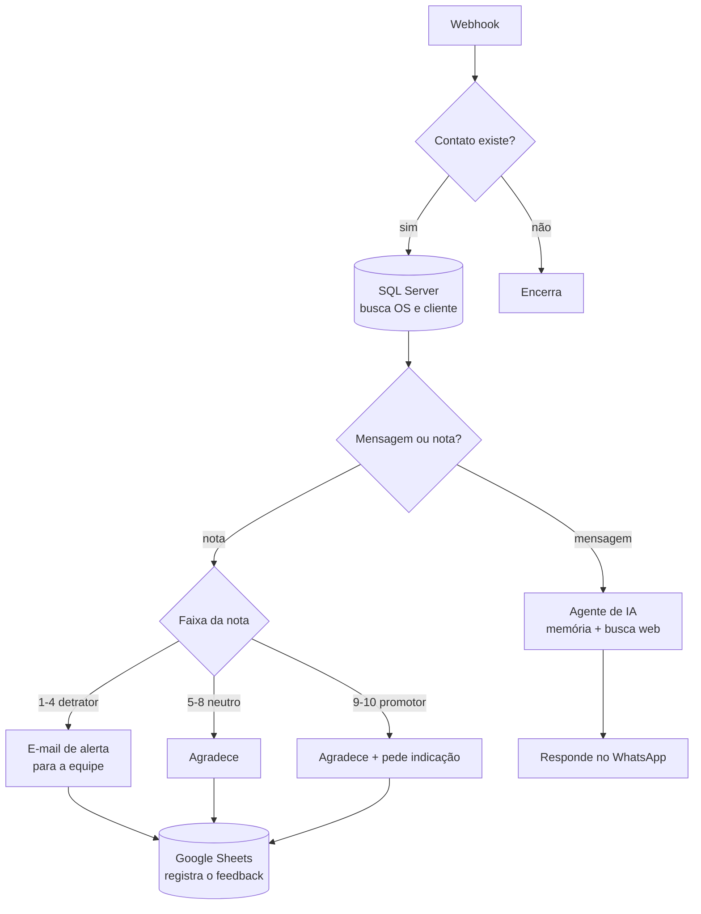

# n8n-nps-atendimento

Fluxo n8n que coleta NPS após um atendimento, trata a nota conforme a faixa e
mantém um agente de IA para a conversa que vem depois.

34 nós. Webhook de entrada, consulta a ERP em SQL Server, ramificação por faixa
de nota, disparo por WhatsApp, registro em planilha, alerta por e-mail e um
agente de IA com memória e busca na web.

## O caminho dos dados

## Decisões que fazem o fluxo não quebrar

**A nota chega como texto livre.** Cliente responde "10!", "nota 9", "dez" ou
manda um áudio. O fluxo separa mensagem de nota antes de ramificar, em vez de
assumir que o corpo é um número.

**Detrator dispara e-mail, não só registro.** Nota de 1 a 4 significa que alguém
precisa ligar hoje. Gravar em planilha e esperar alguém abrir não resolve — o
alerta vai por e-mail no mesmo passo.

**Consulta ao ERP antes de qualquer coisa.** Sem casar o telefone com a ordem de
serviço, o NPS fica solto: dá para saber que a nota foi 3, mas não de qual
atendimento, qual técnico ou qual serviço.

**O agente de IA só entra quando é conversa.** Resposta numérica segue o caminho
determinístico. Mandar tudo para o modelo custa mais e piora o resultado no caso
simples, que é a maioria.

## O que foi retirado desta versão pública

Este fluxo rodava em produção numa operação real. Para publicar:

- **System prompt do agente** (8.300 caracteres) — substituído por um genérico.
  O original trazia histórico da empresa, telefones, horários e o playbook
  comercial.
- **Template HTML do e-mail** (4.700 caracteres) — trocado por uma versão mínima.
- **IDs de credencial** — removidos, ficou só o tipo.
- Razão social, nome de fundador, telefones e e-mails corporativos.

A arquitetura está intacta. É ela que interessa aqui.

## Como usar

1. n8n → **Import from File** → `workflow.json`
2. Recrie as credenciais: SQL Server, Google Sheets, Gmail, OpenAI, SerpAPI e o
   provedor de WhatsApp
3. Ajuste as queries SQL para o seu schema
4. Troque o system prompt do agente pelo seu

## Stack

n8n · SQL Server · Google Sheets · Gmail · OpenAI · SerpAPI · WhatsApp

## Licença

MIT
